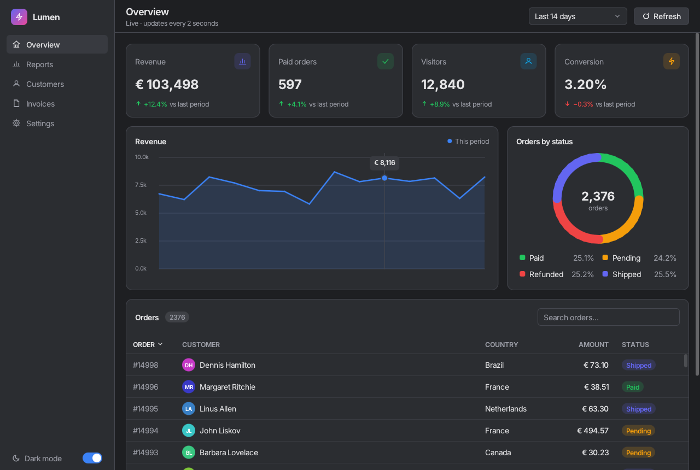
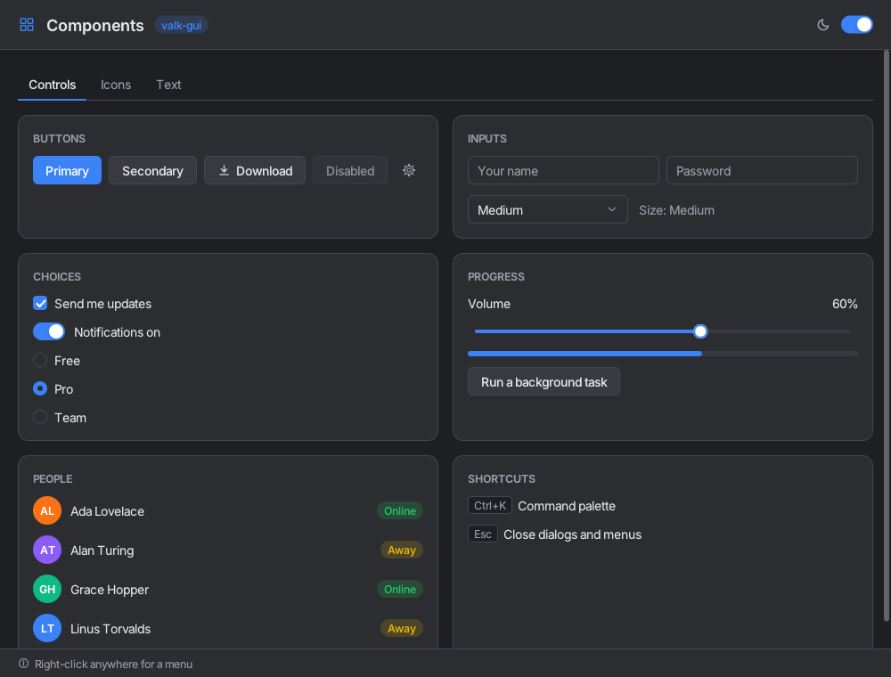
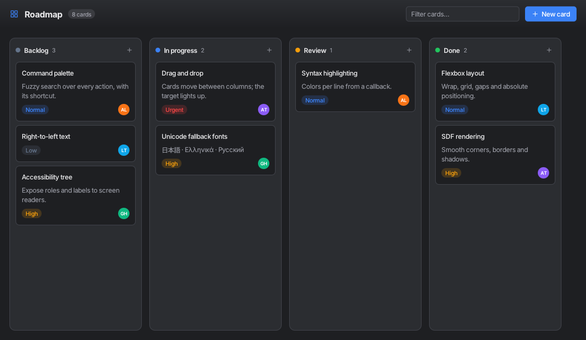
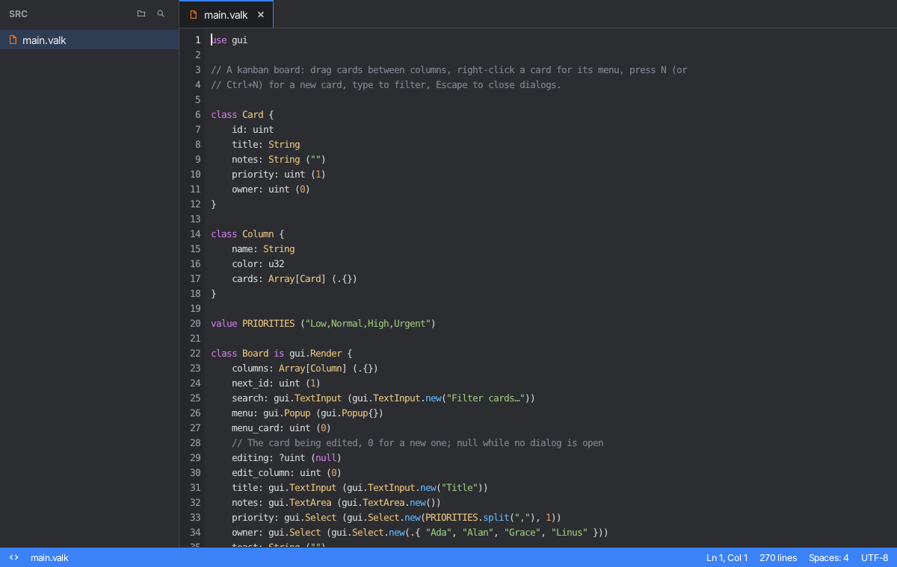

# valk-gui

A GUI library for [Valk](https://valk-lang.dev), in the style of [GPUI](https://gpui.rs):
your state lives in plain classes, `render` builds a tree of elements every frame, and
elements are styled with chained, Tailwind-like methods. Layout is flexbox. Drawing is done on
the GPU through [raylib](https://www.raylib.com).



```rust
use gui

class Counter is gui.Render {
    count: int (0)

    fn render(win: gui.Window) gui.Div {
        return gui.div().size_full().center().gap(16).text_xl()
            .child("Hello, Valk!")
            .child(gui.div().flex().items_center().gap(12)
                .child(gui.button(win, "−").w(40).on_click(fn(e) { this.count-- }))
                .child(gui.div().w(60).text_center().child("%{this.count}"))
                .child(gui.button_primary(win, "+").id("increment").w(40).on_click(fn(e) { this.count++ })))
    }
}

fn main() {
    gui.run(Counter{}, .{ title: "Hello", width: 480, height: 320 })
}
```

## Requirements

Valk 0.8.7 or newer, and raylib 6.0 on the system, as for
[valk-raylib](https://github.com/ctxcode/valk-raylib): `pacman -S raylib`, `brew install raylib`,
or the library from raylib's [release page](https://github.com/raysan5/raylib/releases/tag/6.0).
When it is not where the linker looks, point the build at it:

```sh
valk build . -L ~/raylib-6.0_linux_amd64/lib -o app
LD_LIBRARY_PATH=~/raylib-6.0_linux_amd64/lib ./app
```

## Install

```
vman install github.com/ctxcode/valk-gui
```

## Elements and styles

Everything is a `gui.Div`. `gui.div()` makes a box, `gui.text("...")` a text (or pass a
`String` to `child`), `gui.img(path)` an image and `gui.canvas(fn)` something you draw yourself.
Every style method returns the element, so they chain:

```rust
gui.div().flex().items_center().gap(8).px(12).h(40)
    .bg(gui.rgb(0x2b2d31)).rounded(8).border(1).border_color(gui.rgb(0x45474f))
    .text_sm().font_medium().text_color(gui.white())
    .child(gui.div().size(16).rounded_full().bg(gui.rgb(0x22c55e)))
    .child("Online")
```

| | |
| --- | --- |
| Direction | `flex()` / `flex_row()` (row), `flex_col()` (column, the default) |
| Alignment | `items_start/center/end/stretch`, `justify_start/center/end/between/around/evenly`, `self_*`, `center()` |
| Flexing | `flex_1()`, `flex_grow()`, `flex_shrink_0()`, `flex_none()`, `flex_basis(px)` |
| Size | `w(px)`, `h(px)`, `size(px)`, `w_full()`, `size_full()`, `w_frac(0.5)`, `min_w`, `max_w`, `min_h`, `max_h` |
| Spacing | `p`, `px`, `py`, `pt`, `pr`, `pb`, `pl`, `m`, `mx`, `my`, `mt`, ..., `gap`, `gap_x`, `gap_y` |
| Position | `absolute()` with `top`, `right`, `bottom`, `left`, `inset`; `deferred()` paints on top of everything |
| Overflow | `overflow_hidden()`, `overflow_y_scroll()`, `overflow_x_scroll()`, `overflow_scroll()` |
| Wrapping | `flex_wrap()`; `grid(columns)` with `col_span(n)` on cells |
| Paint | `bg`, `bg_gradient(from, to, angle)`, `border(w)`, `border_t/r/b/l`, `border_color`, `rounded(r)`, `rounded_t/b/l/r/tl/tr/br/bl(r)`, `rounded_full()`, `shadow_sm/md/lg()`, `opacity`, `cursor_pointer()` |
| Text | `text_color`, `text_size(px)`, `text_xs` ... `text_3xl`, `font_medium/semibold/bold()`, `italic()`, `underline()`, `line_through()`, `line_height`, `text_center()`, `truncate()`, `whitespace_nowrap()`, `font(name)` |
| Images | `gui.img(path)` with `object_cover()` or `object_contain()`; `rounded` clips them |
| Visibility | `hidden()` (no space), `invisible()` (keeps its space), `tooltip(text)` |

Text styles are inherited by children. Sizes are logical pixels. Colors come from
`gui.rgb(0xRRGGBB)`, `gui.rgba(0xRRGGBBAA)` or `gui.hsla(h, s, l, a)`, and have `opacity`,
`lighten`, `darken` and `mix`.

State-dependent styles take a closure that changes a copy of the style:

```rust
gui.div().bg(gray)
    .hover(fn(s) { s.bg(light_gray) })
    .active(fn(s) { s.bg(dark_gray) })
    .when(selected, fn(d) { d.border(2).border_color(blue) })
```

## State and events

Handlers are closures, so they change your state directly. The window draws a new frame after
every input event, and sleeps in between.

```rust
.on_click(fn(e) { this.count++ })                    // the innermost element with a click handler
.on_mouse_down(fn(e) { ... e.local_x ... e.click_count ... e.button })
.on_drag(fn(e) { ... })                              // moves while the button pressed here is held
.on_scroll(fn(e) { ... e.dy ... })
.on_drop_files(fn(paths) { ... })                    // files dropped on the window
```

Parents receive what their children do not stop: `e.stop_propagation()`.

## Drag and drop

```rust
gui.div().draggable(card.id, fn() gui.Div { return gui.div().child(card.title) })   // optional preview
gui.div().on_drop(fn(payload) { this.move_card(payload, column) })
    .drag_over(fn(s) { s.border_color(blue) })       // while something is held over it
```

`win.dragging()` gives the payload in flight, for example to fade the original.

## Time, animation and background work

```rust
win.after(2.5, fn() { this.toast = "" })             // once
let timer = win.every(1, fn() { this.tick() })       // until timer.cancel()
let x = win.transition("panel", open ? 240 : 0, 0.2) // eases to a new target over 0.2 s
win.spawn[String](fn() String { return load() }, fn(result) { this.data = result }) _
```

`spawn` runs its first closure on another thread and the second on the window's thread with the
result; values that cross threads are numbers, strings or `atomic` objects. Call
`win.request_frame()` from `render` to keep drawing, for free-running animations.

## Keyboard and focus

An element takes keyboard focus with a `FocusHandle`. Clicking it focuses it, Tab and Shift+Tab
move between focusable elements, and its key handlers then receive key presses:

```rust
class Editor is gui.Render {
    focus: ?gui.FocusHandle (null)

    fn render(win: gui.Window) gui.Div {
        let focus = this.focus ?? win.focus_handle()
        this.focus = focus
        return gui.div().track_focus(focus)
            .focus(fn(s) { s.border_color(win.theme.accent) })
            .on_key_down(fn(e) {
                if e.key == .s && e.modifiers.secondary : this.save()
            })
            .on_input(fn(text) { this.insert(text) })
    }
}
```

`modifiers.secondary` is Command on macOS and Control elsewhere. The root element receives key
presses when nothing has focus.

Key bindings turn key combinations into named actions, handled by the focused element or one
of its parents; menus and command palettes show them with `win.shortcut(action)`:

```rust
win.bind("secondary-s", "save") _
win.bind("secondary-shift-p", "palette") _
gui.div().on_action("save", fn() { this.save() })
win.dispatch("save")                                 // from code, such as a menu
```

Escape runs the last `on_dismiss` handler in the tree, which closes menus and dialogs.

## Components

`gui.TextInput` (one line) and `gui.TextArea` (many lines, with line numbers, syntax colors and
read-only mode) edit text with selection, word jumps, the clipboard, and undo. `gui.Select` is
a dropdown. Keep these with your state:

```rust
class Login is gui.Render {
    name: gui.TextInput (gui.TextInput.new("Your name"))

    fn render(win: gui.Window) gui.Div {
        this.name.on_submit = fn(text: String) { println("Hello " + text) }
        return gui.div().p(20).gap(10)
            .child(this.name.render(win))
            .child(gui.button_primary(win, "Continue").on_click(fn(e) { println(this.name.text) }))
    }
}
```

The others are functions that return a `Div` to style further: `button`, `button_primary` and
`icon_button`, `checkbox`, `radio`, `switch`, `slider`, `progress`, `spinner`, `tabs`, `badge`,
`kbd`, `avatar`, `card` and `divider`. `gui.icon(.search)` draws one of 50 line icons. They take
their colors from `win.theme`, which is `gui.Theme.dark()` unless `WindowOptions.theme` or
`win.theme` says otherwise.

Menus, popovers and dialogs float above everything:

```rust
// A context menu where the mouse was pressed
.on_mouse_down(fn(e) { if e.button == .right : this.menu.open_at(e.x, e.y) })
.child(this.menu.render(win, gui.menu(win, .{
    gui.MenuItem.new("Copy", fn() { this.copy_text() }).with_icon(.copy).with_shortcut("Ctrl+C"),
    gui.MenuItem.line(),
    gui.MenuItem.new("Delete", fn() { this.delete() }).as_danger()
}, fn() { this.menu.close() })))

// A dialog over a dimmed window
gui.modal(win, gui.dialog(win, "Delete file?", body, .{ cancel_button, delete_button }), fn() { this.open = false })
```

`gui.anchored(x, y)` places any element at a window position and keeps it on screen.
`gui.choose_file(win, fn(path) { ... })` shows the system's file dialog.



## Lists and scrolling

`overflow_y_scroll()` scrolls with the wheel and a draggable scrollbar; give the element an `id`
to keep its position when the tree changes shape. For long lists, `uniform_list` only builds the
rows in view:

```rust
gui.uniform_list(win, "files", this.files.length, 28, fn(i) {
    return gui.div().px(8).child(this.files[i])
}).flex_1()
```

## Drawing

A canvas gets a `Painter` and its bounds:

```rust
gui.canvas(fn(p, b) {
    p.fill(b, gui.rgb(0x1e1f22), 6)
    p.line(b.x, b.bottom, b.right, b.y, gui.rgb(0x3b82f6), 2)
    p.circle(b.center.x, b.center.y, 10, gui.white())
    p.text(b.x + 8, b.y + 8, "Chart", gui.white(), 14)
}).size_full()
```

## Fonts

The built-in font is [Inter](https://rsms.me/inter/) in four weights and italic. Characters it
lacks, such as Chinese or Japanese, come from the system's fonts, or from
`WindowOptions.fallback_fonts`. Add your own families and use them with `font(name)`:

```rust
gui.run(app, .{ fonts: .{ .{ name: "mono", path: "fonts/JetBrainsMono-Regular.ttf" } } })
gui.div().font("mono").child("let x = 1")
```

## Testing

`gui.headless(root, width, height)` gives a window without a screen. It lays out and paints into
`win.scene`, and simulates input, so a UI can be tested like any other code:

```rust
test "the counter counts" {
    let app = Counter{}
    let win = gui.headless(app, 480, 320)
    win.click_on("increment")        // the element with .id("increment")
    assert(app.count == 1)
    assert(win.scene.has_text("1"))
    win.press(.tab)
    win.type_text("hello")
}
```

Text is measured as if every character were half the font size wide. `win.advance(seconds)`
moves the clock for timers and animations, and `win.wait_tasks()` waits for `spawn`ed work.

`VALK_GUI_SCREENSHOT=out.png ./app` saves the third frame of any app and exits.

## Examples

`make <name>` builds and runs one:

| | |
| --- | --- |
| `hello` | the counter above |
| `todo` | a task list with filters and a theme switch |
| `gallery` | every component and icon, Unicode text, a background task |
| `kanban` | drag cards between columns, card dialogs, context menus, shortcuts |
| `editor` | file tree, tabs, syntax colors, command palette, find in files; `make editor` opens this repository |
| `dashboard` | live charts, animated numbers, a sortable table of 5000 rows |
| `showcase` | canvas drawing, sliders and a long list |





## Not supported

One window per program, no right-to-left text or input methods (IME), no native menu bar, no
accessibility tree. Text areas do not wrap lines.

## Development

```sh
make raylib              # download raylib 6.0 into vendor/raylib (when it is not installed)
make test                # headless tests
make test-window         # opens a hidden window and checks the pixels; needs a display
make kanban              # build and run an example (see Examples)
make examples            # build them all
make docs                # docs/api.md
```
